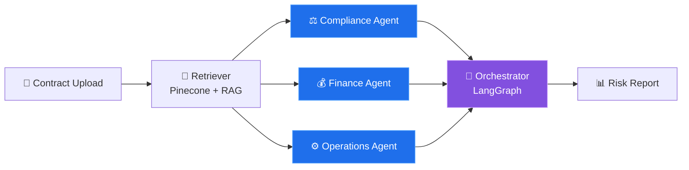
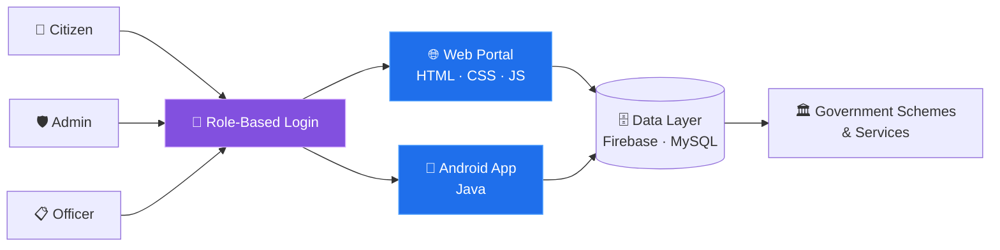
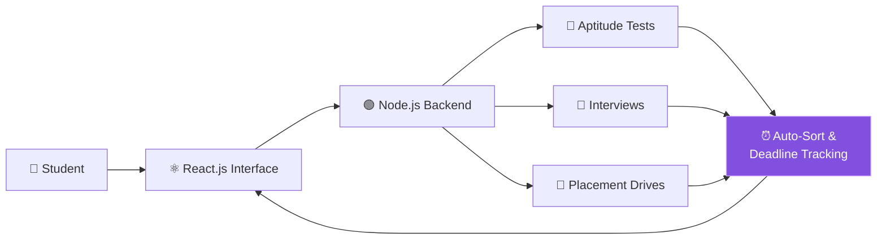
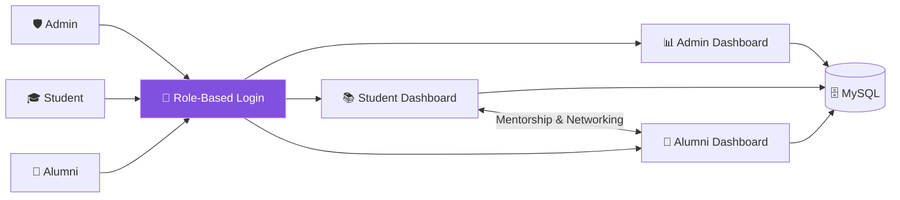
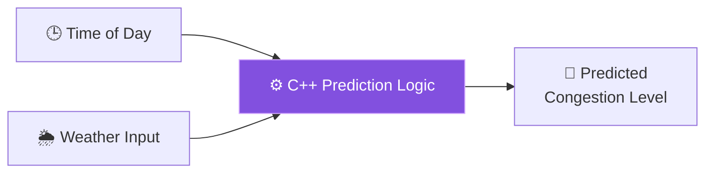
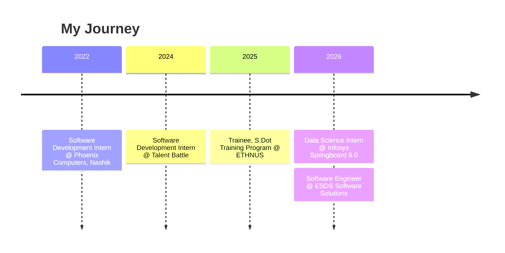

<div align="center">


<a href="https://github.com/Vaishnavi-1525">
  
</a>

<br/>

<a href="https://www.linkedin.com/in/vaishnavi-kanade-b92a08224"></a>
<a href="https://vaishnavi-1525.github.io/"></a>
<a href="mailto:vaishnavikanade1525@gmail.com"></a>


</div>

<br/>

## 👩‍💻 whoami

```bash
vaishnavi@github:~$ whoami
Vaishnavi Kanade — Software Engineer

vaishnavi@github:~$ cat profile.txt
🎓 B.E. Information Technology Graduate (2026) · PVGCOE Nashik
💼 Software Engineer Trainee @ ESDS Software Solutions [Working]
📊 Ex-Data Science Intern @ Infosys Springboard
☁️ AWS Academy Graduate — Cloud Foundations & Cloud Architecting
🔭 Focus: Full-Stack · Mobile · AI (RAG & Multi-Agent Systems)

vaishnavi@github:~$ status
🟢 Starting my journey as a Software Engineer
```

---

## 💡 About Me

I'm an Information Technology graduate with an interest in software development, AI-powered applications, and backend technologies. I enjoy building practical projects and understanding how software systems work end-to-end.

My experience includes working with **Java, C++ and SQL**, web and mobile development, along with AI technologies such as **RAG, LangChain, LangGraph, and Pinecone**. I gained industry experience during my internship at ESDS Software Solutions and I'm now stepping into a **Software Engineer** role.

Some of my key projects include **ClauseAI**, a multi-agent AI-based contract risk analyzer, and **GramLink-AI**, a web and Android platform designed to connect rural citizens with government services.

---

## 🚀 Technologies & Concepts I've Applied

| 🔥 Concept | What it is | Where I applied it |
|:--|:--|:--|
| **RAG Pipelines** | Grounding LLM answers in your own documents | ClauseAI |
| **Multi-Agent Systems** | Specialist AI agents working together on one task | ClauseAI |
| **Vector Search** | Semantic retrieval with Pinecone | ClauseAI |
| **Android Development** | Native mobile apps with Java & Firebase | GramLink-AI |
| **Role-Based Access Control** | Separate dashboards & permissions per user type | GramLink-AI · Alumni Tracking System |
| **Full-Stack Web Development** | React / Node.js and PHP / MySQL applications | NextStep · Alumni Tracking System |
| **Data Structures & Algorithms** | Problem solving in Java | DSA-Java · 100 Days Challenge |
| **Cloud Fundamentals** | Core AWS services & architecture | AWS Academy (Cloud Foundations & Architecting) |

---

## 🛠️ Projects

> 👇 Click any project to expand it and see how it works.

<details open>
<summary><b>🤖 ClauseAI — AI Contract Risk Analysis</b></summary>
<br/>

AI system that reads and analyzes legal contracts using a **multi-agent architecture** (compliance, finance, operations agents), flags risky clauses, and auto-generates reports.




[🔗 View repository](https://github.com/Vaishnavi-1525/ClauseAI-AI-Contract-Risk-Analysis)

</details>

<details>
<summary><b>🏘️ GramLink-AI — Rural Citizen–Government Portal</b></summary>
<br/>

Web + mobile portal bridging rural citizens with government schemes, with role-based access for citizens, admins and officers.




[🔗 View repository](https://github.com/Vaishnavi-1525/GramLink-AI)

</details>

<details>
<summary><b>🎯 NextStep — Smart Job & Placement Tracker</b></summary>
<br/>

Tracks aptitude tests, interviews and placement drives with auto-sorting and deadline tracking.




[🔗 View repository](https://github.com/Vaishnavi-1525/NextStepTracker)

</details>

<details>
<summary><b>🎓 Alumni Tracking System — Mentorship & Networking</b></summary>
<br/>

Connects alumni with students for mentorship and networking, with role-based dashboards for Admin, Students and Alumni.




[🔗 View repository](https://github.com/Vaishnavi-1525/Alumni_Tracking_System)

</details>

<details>
<summary><b>🚦 Traffic Congestion Predictor — Real-Time Prediction</b></summary>
<br/>

Predicts traffic levels from time and weather inputs in real time.




[🔗 View repository](https://github.com/Vaishnavi-1525/Traffic-Congestion-Predictor)

</details>

---

## 📘 Practice & Consistency

| | Repository | Details |
|:-:|:--|:--|
| 🧮 | [**DSA-Java**](https://github.com/Vaishnavi-1525/DSA-Java) | Data structures & algorithms implemented in Java |
| 🔥 | [**100 Days DSA Challenge**](https://github.com/Vaishnavi-1525/100-Days-Challenge) | ✅ **Completed 🎉** Day 1 → Day 100, daily Java practice |

---

## 💼 Experience Timeline



> 👇 Click a role to see its details.

<details open>
<summary><b>🚀 Software Engineer</b> — ESDS Software Solutions Limited <code>2026 · Working</code></summary>
<br/>

- 🏢 **Organization:** ESDS Software Solutions Limited, Nashik
- 📅 **Duration:** 2026 – Present
- 🎯 **Role:** Software Engineer

</details>

<details>
<summary><b>📊 Data Science Intern (Virtual)</b> — Infosys Springboard Internship 6.0 <code>Jan 2026 – Apr 2026</code></summary>
<br/>

- 🏢 **Organization:** Infosys Springboard Internship 6.0
- 📅 **Duration:** Jan 2026 – Apr 2026
- 🎯 **Role:** Data Science Intern (Virtual)

</details>

<details>
<summary><b>🎓 Trainee, S.Dot Training Program</b> — ETHNUS <code>Jun 2025 – Jul 2025</code></summary>
<br/>

- 🏢 **Organization:** ETHNUS
- 📅 **Duration:** Jun 2025 – Jul 2025
- 🎯 **Role:** Trainee, S.Dot Training Program

</details>

<details>
<summary><b>💻 Software Development Intern</b> — Talent Battle <code>Dec 2024 – Jan 2025</code></summary>
<br/>

- 🏢 **Organization:** Talent Battle
- 📅 **Duration:** Dec 2024 – Jan 2025
- 🎯 **Role:** Software Development Intern

</details>

<details>
<summary><b>💻 Software Development Intern</b> — Phoenix Computers, Nashik <code>Jul 2022 – Aug 2022</code></summary>
<br/>

- 🏢 **Organization:** Phoenix Computers, Nashik
- 📅 **Duration:** Jul 2022 – Aug 2022
- 🎯 **Role:** Software Development Intern

</details>

---

## 🧰 Tech Stack

<div align="center">

**Languages**<br/>


**AI / NLP**<br/>


<br/><br/>

**Web, Mobile & Backend**<br/>


**Cloud & Tools**<br/>


</div>

---

## 📊 GitHub Stats

<div align="center">


<br/>

<picture>
  <source media="(prefers-color-scheme: dark)" srcset="https://raw.githubusercontent.com/Vaishnavi-1525/Vaishnavi-1525/output/github-snake-dark.svg" />
  <source media="(prefers-color-scheme: light)" srcset="https://raw.githubusercontent.com/Vaishnavi-1525/Vaishnavi-1525/output/github-snake.svg" />
  
</picture>

</div>

---

<div align="center">

### 📬 Let's Connect

[Email](mailto:vaishnavikanade1525@gmail.com) · [LinkedIn](https://www.linkedin.com/in/vaishnavi-kanade-b92a08224) · [Portfolio](https://vaishnavi-1525.github.io/)

*Excited to build, learn and ship — always happy to talk Java, Android, full-stack or AI — Open to Software Developer roles* 🚀


</div>
