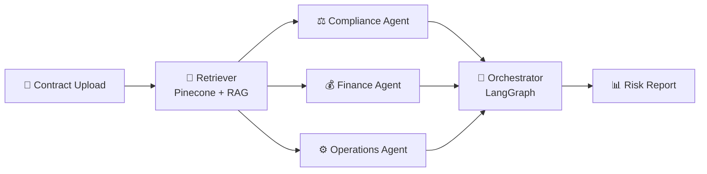
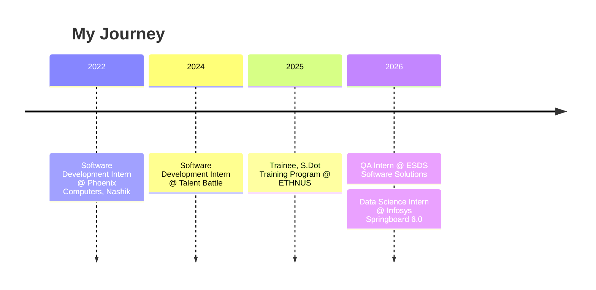

<div align="center">

<!-- Custom animated banner: save banner.svg at assets/banner.svg in this repo -->


<a href="https://github.com/Vaishnavi-1525">
  
</a>

<br/>

<a href="https://www.linkedin.com/in/vaishnavi-kanade-b92a08224"></a>
<a href="https://vaishnavi-1525.github.io/"></a>
<a href="mailto:vaishnavikanade1525@gmail.com"></a>


</div>

<br/>

## 👩‍💻 whoami

```bash
vaishnavi@github:~$ whoami
Vaishnavi Kanade — Software Developer in the making

vaishnavi@github:~$ cat profile.txt
🎓 B.E. Information Technology Graduate (2026) · PVGCOE Nashik
🧪 QA Intern @ ESDS Software Solutions
📊 Ex-Data Science Intern @ Infosys Springboard
☁️  AWS Academy Graduate — Cloud Foundations & Cloud Architecting
🔭 Focus: RAG · Multi-Agent Systems · NLP

vaishnavi@github:~$ status
🟢 Open to Software Developer roles
```

---

## 💡 About Me

I'm an Information Technology graduate with an interest in software development, AI-powered applications, and backend technologies. I enjoy building practical projects and understanding how software systems work end-to-end.

My experience includes working with **Java, Python, SQL**, web and mobile development, along with AI technologies such as **RAG, LangChain, LangGraph, and Pinecone**. I have also gained industry experience in software testing and quality assurance during my internship at ESDS Software Solutions.

Some of my key projects include **ClauseAI**, a multi-agent AI-based contract risk analyzer, and **GramLink-AI**, a web and Android platform designed to connect rural citizens with government services.

---

## 🚀 Tech I'm Riding (2026 Trends)

> _Edit the status column so it matches exactly where you are._

| 🔥 Trend | What it means | My status |
|:--|:--|:--|
| **Agentic AI** | AI systems that plan, use tools and collaborate | 🟢 Building (ClauseAI) |
| **RAG** | Grounding LLMs in your own documents | 🟢 Building |
| **Multi-Agent Orchestration** | Specialist agents coordinated with LangGraph | 🟢 Building |
| **Vector Databases** | Semantic search with Pinecone | 🟢 Using |
| **Cloud-Native** | Scalable apps on AWS | 🟡 Learning |
| **AI-assisted Testing / QA** | Using AI to improve software quality | 🟡 Exploring |

---

## 🛠️ Projects

> 👇 Click any project to expand it.

<details open>
<summary><b>🤖 ClauseAI — AI Contract Risk Analysis</b> &nbsp;·&nbsp; <i>flagship</i></summary>
<br/>

AI system that reads and analyzes legal contracts using a **multi-agent architecture** (compliance, finance, operations agents), flags risky clauses, and auto-generates reports.




[🔗 View repository](https://github.com/Vaishnavi-1525/ClauseAI-AI-Contract-Risk-Analysis)

</details>

<details>
<summary><b>🏘️ GramLink-AI</b> — Web + Android portal for rural citizens</summary>
<br/>

Web and mobile portal bridging rural citizens with government schemes, with role-based access for citizens, admins and officers.

`Android` `Java` `Firebase` `HTML/CSS/JS` `MySQL`

[🔗 View repository](https://github.com/Vaishnavi-1525/GramLink-AI)

</details>

<details>
<summary><b>🎯 NextStep</b> — Smart Job & Placement Tracker</summary>
<br/>

Tracks aptitude tests, interviews and placement drives with auto-sorting and deadline tracking.

`React.js` `Node.js`

[🔗 View repository](https://github.com/Vaishnavi-1525/NextStepTracker)

</details>

<details>
<summary><b>🎓 Alumni Tracking System</b> — Mentorship & networking</summary>
<br/>

Connects alumni with students for mentorship and networking, with role-based dashboards for Admin, Students and Alumni.

`Java` `PHP` `MySQL` `HTML/CSS`

[🔗 View repository](https://github.com/Vaishnavi-1525/Alumni_Tracking_System)

</details>

<details>
<summary><b>🚦 Traffic Congestion Predictor</b> — Real-time traffic prediction</summary>
<br/>

Predicts traffic levels from time and weather inputs in real time.

`C++`

[🔗 View repository](https://github.com/Vaishnavi-1525/Traffic-Congestion-Predictor)

</details>

---

## 📘 Practice & Consistency

| | Repository | Details |
|:-:|:--|:--|
| 🧮 | [**DSA-Java**](https://github.com/Vaishnavi-1525/DSA-Java) | Data structures & algorithms implemented in Java |
| 🔥 | [**100 Days DSA Challenge**](https://github.com/Vaishnavi-1525/100-Days-Challenge) | ✅ **Completed 🎉** Day 1 → Day 100, daily Java practice |

---

## 💼 Experience Timeline



<details>
<summary>📋 Full details</summary>
<br/>

| Role | Organization | Duration |
|:--|:--|:--|
| Quality Assurance Intern | ESDS Software Solutions Limited | Feb 2026 – Present |
| Data Science Intern (Virtual) | Infosys Springboard Internship 6.0 | Jan 2026 – Apr 2026 |
| Trainee, S.Dot Training Program | ETHNUS | Jun 2025 – Jul 2025 |
| Software Development Intern | Talent Battle | Dec 2024 – Jan 2025 |
| Software Development Intern | Phoenix Computers, Nashik | Jul 2022 – Aug 2022 |

</details>

---

## 🧰 Tech Stack

<div align="center">

**Languages**<br/>


**AI / NLP**<br/>


<br/><br/>

**Web, Mobile & Backend**<br/>


**Cloud & Tools**<br/>


</div>

---

## 📊 GitHub Stats

<div align="center">


<!-- Uncomment AFTER the snake workflow has run once (see .github/workflows/snake.yml)

-->

</div>

---

<div align="center">

### 📬 Let's Connect

[Email](mailto:vaishnavikanade1525@gmail.com) · [LinkedIn](https://www.linkedin.com/in/vaishnavi-kanade-b92a08224) · [Portfolio](https://vaishnavi-1525.github.io/)

*Open to Software Developer roles — always happy to talk RAG, multi-agent systems, or just code* 🚀


</div>
